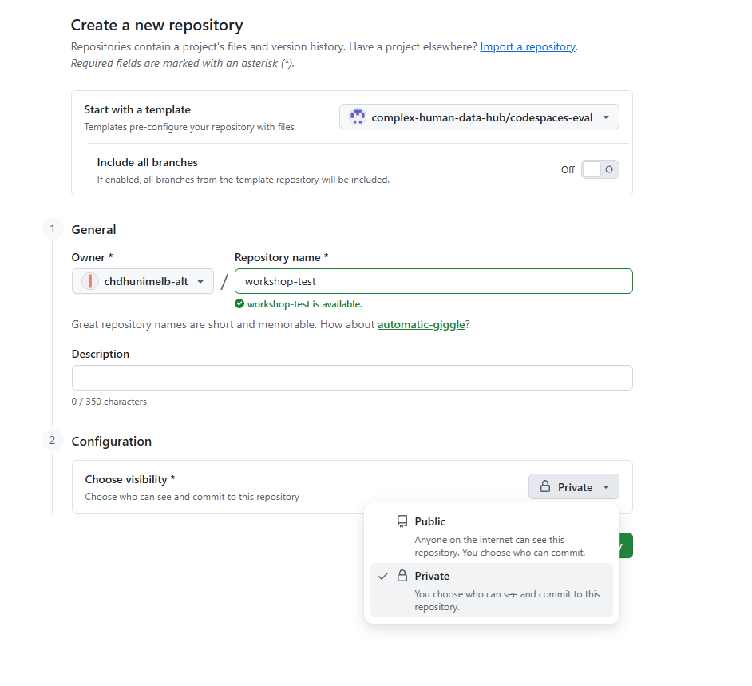

# Make your own copy of the workshop materials

**Step 1 of 5**

Signed in to GitHub, open the workshop repository link (we'll share it), and click the green
**Use this template → Create a new repository** button.

On the form:

- **Owner:** your account (already selected)
- **Repository name:** anything you like — `vc-workshop` works
- **Visibility:** choose **Private** (the form defaults to Public — flip it)

Click **Create repository**. You now own a complete copy of the materials — this is *your*
repository, and everything you do in the workshop happens in it.

<a href="account.html" style="padding:0.6rem 1.2rem;background:#eee;color:#333;border-radius:0.3rem;text-decoration:none;">← Back</a>
<a href="step2.html" style="padding:0.6rem 1.2rem;background:#159957;color:#fff;border-radius:0.3rem;text-decoration:none;font-weight:bold;">Step 2: Launch your codespace →</a>

