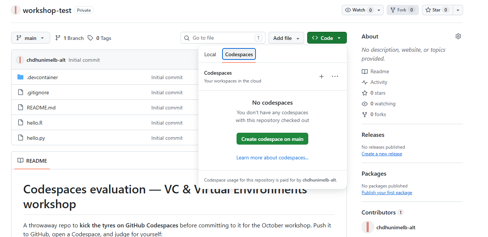

<nav class="wk-nav">
<a href="index.html">Start</a>
<a href="step1.html">1. Copy</a>
<a href="step2.html" class="current">2. Launch</a>
<a href="step3.html">3. Build</a>
<a href="step4.html">4. Trust</a>
<a href="step5.html">5. RStudio</a>
<a href="done.html">Setup complete</a>
</nav>

# Launch your codespace

**Step 2 of 5**

On your new repository's page: click the green **Code** button → **Codespaces** tab →
**Create codespace on main**.

> **"Paid for by you"?** That footer means the codespace runs on your account's **free
> monthly allowance** (120 core-hours; the whole workshop uses about 4). No payment
> details are involved, and GitHub stops rather than charges if you ever run out.

<a href="step1.html" style="padding:0.6rem 1.2rem;background:#eee;color:#333;border-radius:0.3rem;text-decoration:none;">← Back</a>
<a href="step3.html" style="padding:0.6rem 1.2rem;background:#159957;color:#fff;border-radius:0.3rem;text-decoration:none;font-weight:bold;">Step 3: Wait out the build →</a>

