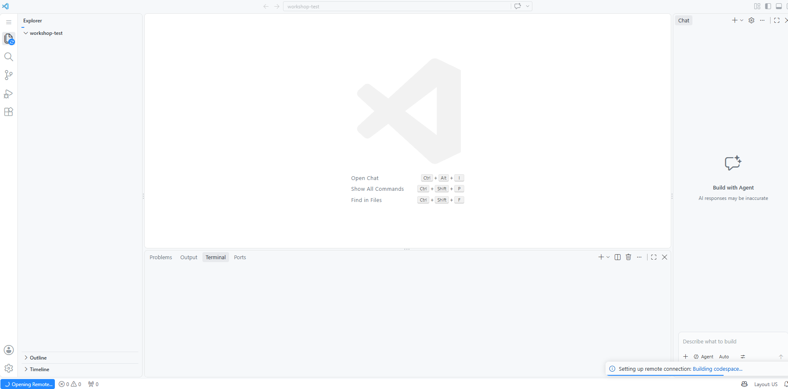

<nav class="wk-nav">
<a href="index.html">Start</a>
<a href="step1.html">1. Copy</a>
<a href="step2.html">2. Launch</a>
<a href="step3.html" class="current">3. Build</a>
<a href="step4.html">4. Trust</a>
<a href="step5.html">5. RStudio</a>
<a href="done.html">Done</a>
</nav>

# Wait out the build (~8 minutes) ☕

**Step 3 of 5**

Here's the one confusing part. Almost immediately you'll see what looks like a finished
editor, **with no files in it**:

**It's not broken, and it's not done.** The small "Building codespace…" message in the
corner is the real progress indicator. Your environment (a complete Linux machine with R,
RStudio, Python and git) is being assembled behind the scenes. Leave the tab alone.

**It's ready when your files appear in the list on the left.**

<a href="step2.html" style="padding:0.6rem 1.2rem;background:#eee;color:#333;border-radius:0.3rem;text-decoration:none;">← Back</a>
<a href="step4.html" style="padding:0.6rem 1.2rem;background:#159957;color:#fff;border-radius:0.3rem;text-decoration:none;font-weight:bold;">Step 4: The trust dialog →</a>

