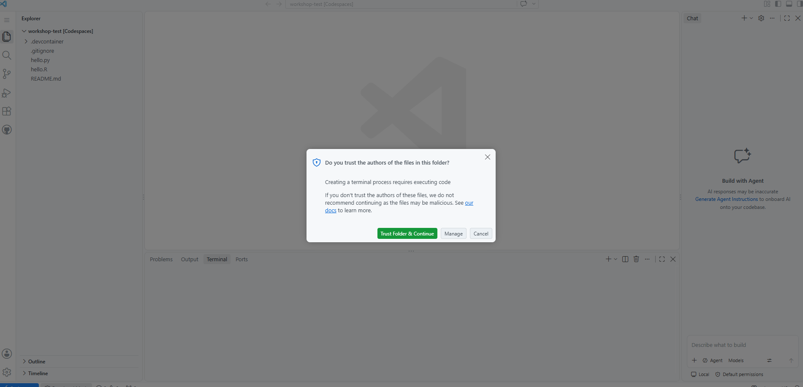

<nav class="wk-nav">
<a href="account.html">Start</a>
<a href="step1.html">1. Copy</a>
<a href="step2.html">2. Launch</a>
<a href="step3.html">3. Build</a>
<a href="step4.html" class="current">4. Trust</a>
<a href="step5.html">5. RStudio</a>
<a href="done.html">Done</a>
<a href="index.html" class="wk-alt">Single page ⤢</a>
</nav>

# Click "Trust Folder & Continue"

**Step 4 of 5**

When the build finishes, a dialog asks whether you trust the authors of this code:

The author is **you**: you created this repository in Step 1. Click the green
**Trust Folder & Continue**. (Clicked Cancel by accident? Just reload the page.)

While you're at it, your browser may also ask permission for the **clipboard**: click
**Allow**. That's what lets you copy-paste commands during the workshop.

<a href="step3.html" style="padding:0.6rem 1.2rem;background:#eee;color:#333;border-radius:0.3rem;text-decoration:none;">← Back</a>
<a href="step5.html" style="padding:0.6rem 1.2rem;background:#159957;color:#fff;border-radius:0.3rem;text-decoration:none;font-weight:bold;">Step 5: Open RStudio →</a>

