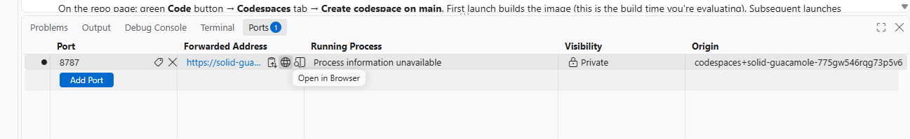

# Open RStudio

**Step 5 of 5**

At the bottom of the editor, find the **Ports** tab (next to Terminal). Hover over the
**8787 "RStudio Server"** row and click the **globe icon** (Open in Browser):

RStudio opens in a new tab, no login needed.

> ⚠️ **Always use the globe icon** — don't type the address by hand, and don't change the
> port's visibility (Private is what keeps your RStudio yours). If the new tab sticks on
> *"getting your codespace ready"* for more than half a minute: go back to the Ports panel,
> use the **copy icon** to copy the address, and paste it into a new tab once — after that
> the globe works normally.

<a href="step4.html" style="padding:0.6rem 1.2rem;background:#eee;color:#333;border-radius:0.3rem;text-decoration:none;">← Back</a>
<a href="done.html" style="padding:0.6rem 1.2rem;background:#159957;color:#fff;border-radius:0.3rem;text-decoration:none;font-weight:bold;">Done →</a>

